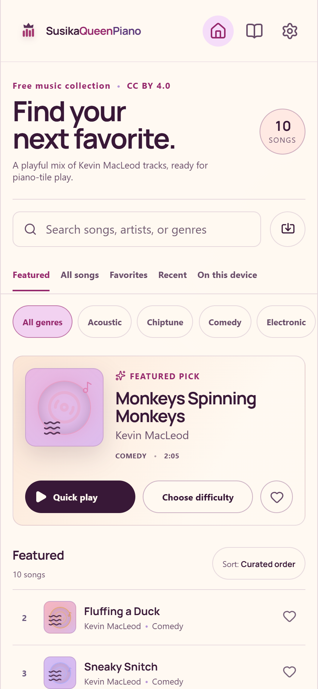
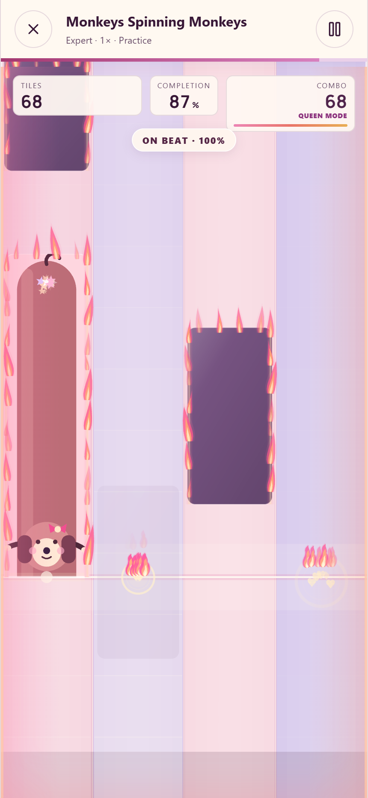
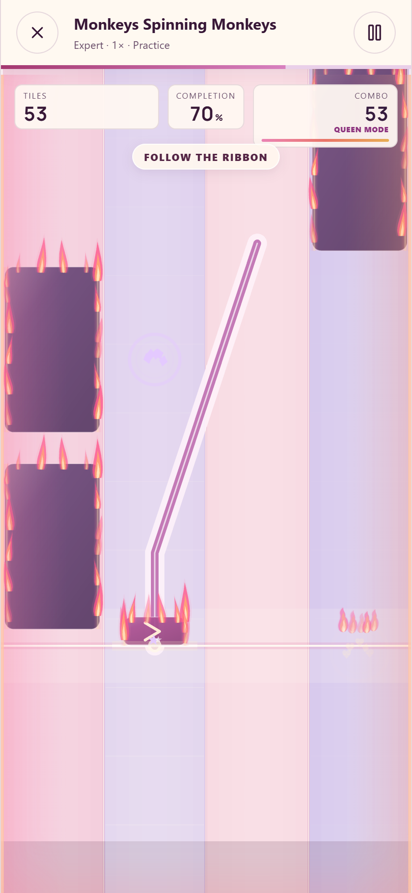

# SusikaQueenPiano

A little love letter you can play with two thumbs.

Made with love for Susika, shared with everyone who enjoys music and little sausage dogs. Pick a song, find your rhythm, and turn a good streak into a stage full of pink and peach flames.

**[Download for Android](https://github.com/mckrosekri/SusikaQueenPiano/releases/latest) · [Player guide](docs/PLAYING.md) · [Build it yourself](#run-locally)**

[](https://github.com/mckrosekri/SusikaQueenPiano/actions/workflows/verify.yml)

## A peek at the stage

<p align="center">
  
  
  
</p>

Browse a song. Hold a little dog. Follow the ribbon. These are real browser captures of the included music, with scripted inputs in practice mode.

## What is inside

- Four portrait lanes, with charts designed for **at most two fingers**.
- Forgiving taps, full-length dachshund holds, flicks and moving slide ribbons.
- Ten free licensed songs, organized by genre, plus private on-device imports.
- Easy through Expert, star unlocks, practice sections and local leaderboards.
- Cute particles and combo flames, with reduced and minimal effects options.
- Offline play on Android, and a browser build for desktop or mobile.

Built with React, PixiJS, Web Audio and Capacitor. The source is MIT; recordings keep their separate CC BY credits. You can build, remix and share the game with those notices included.

## Start playing on Android

1. Open [GitHub Releases](https://github.com/mckrosekri/SusikaQueenPiano/releases/latest) and download the `.apk` under **Assets**.
2. Open it on Android 10 or newer. If asked, allow your browser or file manager to install apps from that source.
3. Choose a song, start on **Easy**, and tap **Start performance**. Two thumbs are all you need.

The downloadable APK is a debug build for direct testing. For controls, practice, imports and audio alignment, see the [player guide](docs/PLAYING.md).

## Play

Tap tiles while they are visible. The center of a tap or flick reaches the glowing rhythm line on the musical attack: hits close to that line earn more points. Hold dogs through their tails and follow slides across lanes to earn their full sustain credit. Charts require at most two fingers. Misses reset the combo but never stop the song.

Easy, Normal, Hard and Expert add musical detail and coordination. Playback speed is a separate choice (0.75x, 1x, 1.25x or 1.5x). Complete a song with at least one star to unlock its next difficulty; one/two/three stars require 50%/75%/90% credit. Practice does not earn unlocks. Leaderboards and progress are stored locally on the device.

## Run locally

Requires Node.js 22.12 or newer and npm.

```sh
npm ci
npm run dev
```

Open http://127.0.0.1:5178. Keyboard lanes are **D F J K**. Dogs use held keys; directional gestures use touch or a mouse.

```sh
npm run verify
npm run music:verify
```

The repository includes all ten audio files and their precomputed analysis. No account, download service, FFmpeg or AI model is needed to play or perform a normal web build.

## Music collection

Ten recognizable internet/video tracks by **Kevin MacLeod**, licensed separately under **CC BY 4.0**:

| Track | Collection |
|---|---|
| Monkeys Spinning Monkeys | Comedy |
| Fluffing a Duck | Comedy |
| Sneaky Snitch | Comedy |
| Carefree | Acoustic |
| Local Forecast - Elevator | Jazz |
| Scheming Weasel (faster version) | Comedy |
| Cipher | Electronic |
| Pixel Peeker Polka - faster | Chiptune |
| Jaunty Gumption | Electronic |
| Merry Go | Piano |

See [music credits](public/licenses/attribution.txt) and [recording provenance](public/licenses/provenance.json). Genre labels above are editorial collections. Recordings were re-encoded at 112 kbps; no musical edits were made. Preserve credits and the license when sharing the game or recordings.

To regenerate the bundle, install FFmpeg on PATH, then run `npm run music:prepare`. The manifest is `scripts/free-music.json`. The pipeline verifies official recording metadata, scans the exact bundled audio, fits musical phase to source BPM, and checks every difficulty at every supported speed. It stages replacements before publishing the catalog. Local review reports are written to ignored `output/`.

## Import your own songs

Import MP3, WAV or M4A/AAC files up to 40 MB and six minutes. Audio, fingerprints, analysis and progress stay in local IndexedDB. There is no audio upload or online leaderboard. Spectral analysis finds attacks and conservative tonal holds; it is not instrument or piano transcription. Lanes, chords, flicks and slides are game gestures. Automated charts are playable but are not claimed to be professionally transcribed or approved by human listening.

## Android

Requires Java 21 and Android SDK/API 36. Set `ANDROID_HOME`/`ANDROID_SDK_ROOT` or create the ignored `android/local.properties` with your SDK location.

```sh
npm run android:sync
```

Then build with `cd android && ./gradlew assembleDebug` on macOS/Linux, or `npm run android:debug` on Windows. The APK is `android/app/build/outputs/apk/debug/app-debug.apk`. Android 10 or newer is supported; orientation is portrait. Debug APKs are for direct testing, not a signed Play Store release. Create and protect your own signing key for store distribution.

## Structure

- `src/components`: library, game stage, results, settings and local leaderboards.
- `src/rhythm`: deterministic audio analysis, arrangement, two-finger budgeting, geometry and judgement.
- `src/audio`: audible-output-clock transport and pitch-preserving speed changes.
- `src/services`: private imports, persistence and redacted diagnostics.
- `public/audio`, `public/charts`: redistributable music and measured analysis.
- `android`: native Capacitor shell and project-owned artwork.

Effects are pooled and bounded. Reduced-motion settings suppress decorative flames and particles while preserving readable tile movement. Backgrounding and audio interruptions pause the game.

## License

First-party code and original artwork: **MIT**, see [LICENSE](LICENSE). Music: **CC BY 4.0**. Font: **OFL-1.1**. Dependencies retain their own licenses, including unmodified SoundTouchJS under **MPL-2.0**. See [asset licenses](ASSET_LICENSES.md) and [third-party notices](THIRD_PARTY_NOTICES.md).

See [CONTRIBUTING.md](CONTRIBUTING.md) for development guidelines.
