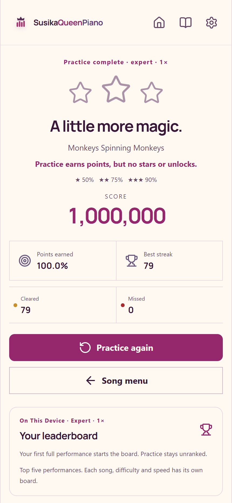

# Playing SusikaQueenPiano

SusikaQueenPiano is a small offline rhythm game made with love for Susika and shared for anyone who enjoys music and little sausage dogs.

## Install on Android

SusikaQueenPiano supports Android 10 and newer. Download the latest debug APK from [GitHub Releases](https://github.com/mckrosekri/SusikaQueenPiano/releases/latest), open the downloaded file, and follow Android's install prompts. If Android asks, allow your browser or file manager to install apps from that source, then return to the installer. The release APK is a debug build for direct testing, not a Play Store build.

## Start with a song

Open a song, choose **Easy**, and select **Start performance**. The game is portrait-only, with four lanes designed to need no more than two fingers. On a desktop browser, use **D**, **F**, **J**, and **K** for the lanes; touch or a mouse can perform swipes and slides.

The **Song setup** screen also has a **Preview song** button and a separate **Playback speed** choice: 0.75x, 1x, 1.25x, or 1.5x. Scores are kept separately for each song, difficulty, and speed.

## How to play

Press a visible tile in its lane. The closer the middle of a tap tile is to the glowing rhythm line, the more points it earns; early or late visible taps still count for less.

- Hold each dog all the way through its tail for full credit.
- Keep your finger on a moving slide and follow its ribbon across the lanes.
- Swipe in the direction shown by an arrow tile for a flick.

Misses reset the combo, but the song keeps playing. Pause is available in the top-right of the stage; resuming gives a short countdown.

## Stars, difficulties, and leaderboards

Finish a non-practice performance with at least 50% to earn one star and unlock the next difficulty:

| Stars | Points earned |
| --- | --- |
| ★ | 50% |
| ★★ | 75% |
| ★★★ | 90% |

The path is **Easy → Normal → Hard → Expert**. Your leaderboard is local to the device: it keeps the top five full performances for each song, difficulty, and playback speed. Practice runs remain unranked and do not create stars, unlocks, personal bests, or leaderboard entries.

An example practice finish from scripted browser play. Practice lets you learn without changing your ranked records.

## Practice a section

On **Song setup**, turn on **Practice section**. You can choose a **Start** and **End** time in seconds, use any difficulty freely, and turn on **Loop section** to repeat that passage. This is a good place to learn a difficult slide or flick without affecting your ranked results.

## Import private songs

From the library, import an MP3, WAV, M4A, or AAC file up to 40 MB and six minutes long. Imported audio, analysis, and progress stay on your device; they are not uploaded and there is no online leaderboard.

The game automatically makes playable charts by finding attacks and conservative tonal holds. It does not transcribe an instrument or piano performance: lane choices, chords, flicks, and slides are game gestures rather than a claimed note-for-note transcription.

## Tune the game

Open **Settings** to choose a **Note finish**, set **Stage effects** to full, reduced, or minimal, toggle **Haptics**, and adjust **Music volume** and **Hit feedback**.

If the tiles feel early or late, choose **Audio alignment** and press **Adjust**. Select **Start pulse**, tap **Tap to the sound** with the pulse, then use the minus and plus buttons for 5 ms adjustments if needed. **Reset** returns the offset to zero, and **Save calibration** stores the result. You can still tap anywhere on a visible tile; calibration only changes the timing alignment.
